# Core ERD and Join Map

The operational key chain is:

```text
NAME / suEstate / Estate / ESTATE / R_Name
  -> UNIT / suDivision / Unit / UNIT
    -> BLOCK / suBlock / Block
      -> YEAR / Yr / yrFis / Y_Harvest
```

`tbl_CW_weatherAndWater` is the exception: `OILPALM.ID_WeatherStation` joins to
`R_UNIT`, not to `OILPALM.UNIT`.

```mermaid
erDiagram
    OILPALM {
        nvarchar NAME
        nvarchar UNIT
        nvarchar BLOCK
        int YEAR
        nvarchar Growth_Period
        float area_ha
        int palmStandMature_p
        float Y_TOTAL_ton
    }
    tbl_FN_nutActRec {
        nvarchar suEstate
        nvarchar suDivision
        nvarchar suBlock
        int Yr
        float nutActInorgN_kg_p
        float nutActInorgK2O_kg_p
        float nutRecInorgN_kg_p
    }
    tbl_HRR_harvests {
        nvarchar Estate
        nvarchar UNIT
        nvarchar BLOCK
        datetime2 D_Harvest
        int Y_Harvest
        float Y_FFB
        int Y_BunchNo
    }
    tbl_PD_surveys {
        nvarchar ESTATE
        nvarchar UNIT
        nvarchar BLOCK
        datetime2 D_Survey
        int yrFis
        nvarchar PestName
        int P_Severity
    }
    tbl_CW_weatherAndWater {
        nvarchar R_Name
        nvarchar R_UNIT
        float R_YEAR
        float R_rain_mm_1
        int R_NO_dry_month
        float R_waterdeficit
    }
    tbl_areasPalmsBIY_blk_mts {
        nvarchar suEstate
        nvarchar suDivision
        nvarchar suBlock
        int Yr
        int palmAgeMt1_mt
        int palmStandMatureYr_p
    }
    tbl_BBC_bunchCounts {
        nvarchar Estate
        nvarchar Unit
        nvarchar Block
        datetime2 CntDate
        int NoOfPalm
        int BlackBunch
    }
    tbl_planting {
        nvarchar Estate
        nvarchar Unit
        nvarchar Block
        datetime2 Dt_Planted
        nvarchar PMat
        float PlantingDensity
    }
    tbl_PD_controlAct {
        nvarchar ESTATE
        nvarchar UNIT
        nvarchar BLOCK
        datetime2 Dt_App
        int yrFis
        nvarchar Control_Name
        float Amount_App
    }
    tbl_PCD_pesticideAct_dt {
        nvarchar suEstate
        nvarchar suDivision
        nvarchar suBlock
        datetime2 pcdAppDt
        int yrFis
        nvarchar pcdProdName
        float pcdApp_kg
    }
    tbl_FN_soilAnalysis {
        nvarchar NAME
        nvarchar UNIT
        nvarchar BLOCK
        int YEAR
        datetime2 SA_DATE
        float SA_PH_H2O
        float SA_CEC
        float SA_SOM
    }
    tbl_CB_cropBudgetMt {
        nvarchar NAME
        nvarchar UNIT
        nvarchar BLOCK
        int YEAR
        float Y_total_ton_bud
    }
    tbl_CLA_auditResults {
        nvarchar NAME
        nvarchar UNIT
        nvarchar BLOCK
        int YEAR
        datetime2 AuditDate
        int B_harvested
        int B_unharvested
    }

    OILPALM ||--o| tbl_FN_nutActRec : "block-year nutrients"
    OILPALM ||--o{ tbl_HRR_harvests : "block-year harvest events"
    OILPALM ||--o{ tbl_PD_surveys : "block-year pest surveys"
    OILPALM ||--o{ tbl_PD_controlAct : "block-year disease control"
    OILPALM ||--o{ tbl_PCD_pesticideAct_dt : "block-year weed control"
    OILPALM ||--o| tbl_CW_weatherAndWater : "weather station-year"
    OILPALM ||--o| tbl_areasPalmsBIY_blk_mts : "block-year stand"
    OILPALM ||--o{ tbl_BBC_bunchCounts : "block-month bunch counts"
    OILPALM ||--o| tbl_planting : "block planting"
    OILPALM ||--o{ tbl_FN_soilAnalysis : "block-year soil samples"
    OILPALM ||--o| tbl_CB_cropBudgetMt : "block-year budget"
    OILPALM ||--o{ tbl_CLA_auditResults : "block-year audit"
```



## Notes

- `tbl_CW_weatherAndWater` is station-year grain, not block-year.
- `tbl_HRR_harvests`, `tbl_PD_surveys`, `tbl_BBC_bunchCounts`, and
  `tbl_FN_soilAnalysis` are event/monthly tables; aggregate before joining.
- `tbl_CB_cropBudgetMt` is a benchmark, not a feature; it appears backfilled.
- `tbl_BBC_forecastABW` has 2023-2025 data and one null 2026 row; it cannot
  support a 2026 baseline forecast as-is.
